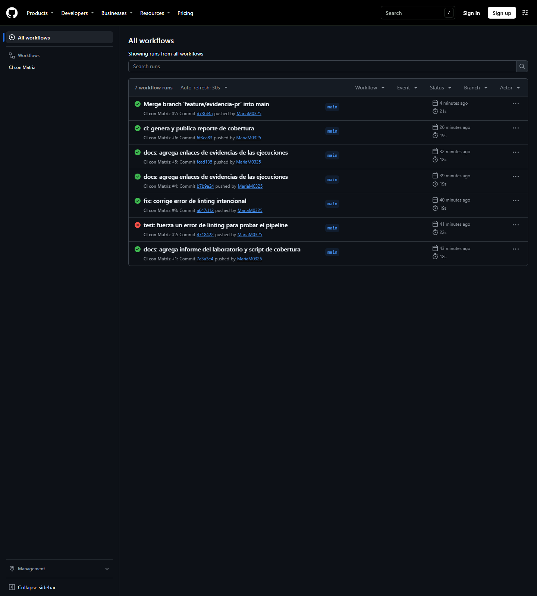
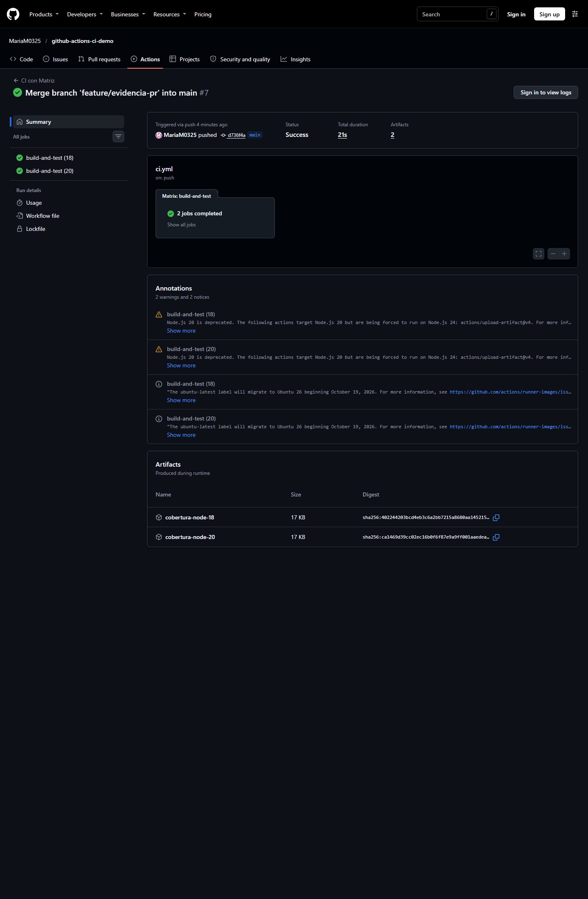
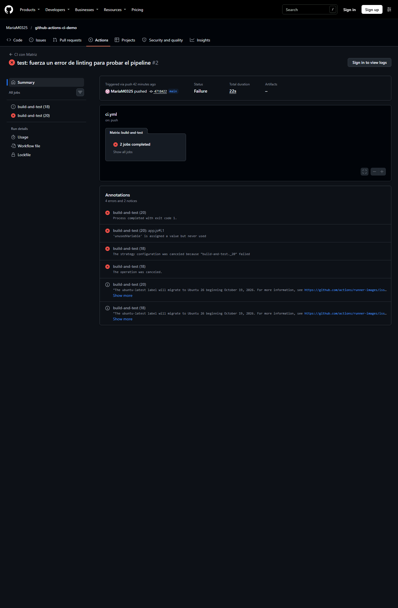

# Informe – Laboratorio 5.1: Workflow de GitHub Actions para CI

## 1. Descripción del proyecto

`github-actions-ci-demo` es una API mínima desarrollada con **Node.js** y **Express** que expone dos endpoints:

- `GET /health`: responde `{ "status": "ok" }`.
- `GET /users`: responde una lista con dos usuarios.

Las pruebas unitarias/de integración se implementan con **Jest** y **Supertest**.

## 2. Pipeline configurado

El workflow se encuentra en `.github/workflows/ci.yml` y se dispara con eventos `push` y `pull_request` sobre la rama `main`.

| Etapa | Descripción |
| ----- | ----------- |
| Checkout | Descarga el código con `actions/checkout@v6`. |
| Setup | Configura Node.js con `actions/setup-node@v6` usando una matriz de versiones 18 y 20. |
| Instalación | Ejecuta `npm ci` para instalar las versiones exactas del `package-lock.json`. |
| Linting | Ejecuta `npm run lint` con ESLint. |
| Pruebas y cobertura | Ejecuta `npm run test:coverage` con Jest y publica el reporte como artifact. |

La matriz genera dos jobs en paralelo, uno por cada versión de Node.js.

> Nota: se fijó ESLint en la versión 9 porque ESLint 10 requiere Node.js ≥ 20 y el job de Node 18 de la matriz fallaría.

## 3. Verificación local

| Comando | Resultado |
| ------- | --------- |
| `npm test` | 2 pruebas aprobadas, 0 fallidas. |
| `npm run lint` | Sin errores. |
| `npm run lint` con una variable no utilizada | Falla con `no-unused-vars`, como se espera. |
| `npm run test:coverage` | 100 % en sentencias, ramas, funciones y líneas. |

## 4. Evidencias

> Los enlaces directos a cada ejecución se incluyen a continuación. Las capturas de pantalla se pueden añadir desde la pestaña **Actions**.

### 4.1 Historial de ejecuciones en la pestaña Actions

- Ejecución exitosa inicial: <https://github.com/MariaM0325/github-actions-ci-demo/actions/runs/43359413037>
- Ejecución fallida intencional (lint): <https://github.com/MariaM0325/github-actions-ci-demo/actions/runs/43359583034>
- Ejecución exitosa tras la corrección: <https://github.com/MariaM0325/github-actions-ci-demo/actions/runs/43359711013>

### 4.2 Detalle de un workflow exitoso con cobertura

La ejecución exitosa completó los jobs `build-and-test (18)` y `build-and-test (20)` con resultado `success`. Cada job ejecuta `npm run test:coverage` y publica el reporte como artifact (`cobertura-node-18` y `cobertura-node-20`). La cobertura es del 100 % en sentencias, ramas, funciones y líneas.

### 4.3 Detalle de un workflow fallido

La ejecución fallida se produjo al introducir la variable `unusedVariable` en `app.js`; el paso de linting falló con la regla `no-unused-vars`. Tras revertir el cambio, el workflow volvió a pasar.

### 4.4 Regla de protección de rama

Regla configurada sobre `main` mediante la API de GitHub:

| Ajuste | Valor |
| ------ | ----- |
| Checks obligatorios | `build-and-test (18)` y `build-and-test (20)` |
| Ramas actualizadas antes del merge | No |
| Revisiones obligatorias | No |
| Enforce admins | No |
| Force push | Bloqueado |
| Eliminación de la rama | Bloqueada |

> La captura visual de `Settings > Branches` se puede añadir manualmente con una sesión iniciada en GitHub.

## 5. Conclusiones

- GitHub Actions permite automatizar la verificación del código en cada cambio sin infraestructura propia.
- El linting detecta errores de estilo y variables no utilizadas antes de llegar a producción.
- Las matrices de ejecución garantizan compatibilidad con varias versiones de Node.js.
- La protección de rama obliga a que el pipeline pase antes de integrar cambios, mejorando la calidad del repositorio.
